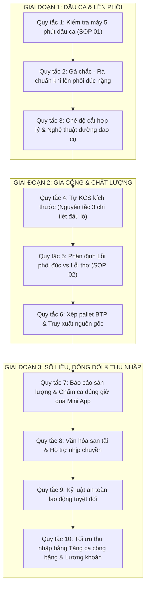

# 📘 CẨM NANG ĐÀO TẠO THỢ NỘI BỘ PHÂN XƯỞNG CƠ KHÍ GCCK 2026
## 10 QUY TẮC THỰC CHIẾN HIỆN TRƯỜNG DÀNH CHO THỢ GIA CÔNG CƠ KHÍ
*Lưu hành nội bộ - Phân Xưởng Gia Công Cơ Khí (GCCK) VICO 2026*  
*Chủ biên & Phê duyệt: Quản Đốc Hoàng Ngọc Hà*  
*Mã tài liệu: `PLAYBOOK-WORKER-GCCK-2026` | Phiên bản: 1.0 (Tháng 10/2026)*

---

```
                       ╔══════════════════════════════════════════════════════╗
                       ║        NHÀ MÁY ĐÚC THÉP HỢP KIM & GCCK VICO 2026     ║
                       ║    "AN TOÀN HÀNG ĐẦU - GÁ ĐẶT CHUẨN XÁC - KHOÁN RÕ RÀNG" ║
                       ╚══════════════════════════════════════════════════════╝
```

---

### 🌟 LỜI MỞ ĐẦU TỪ QUẢN ĐỐC HOÀNG NGỌC HÀ

> *"Anh em thợ thân mến,*  
> *Nghề cơ khí của chúng ta là nghề 'ăn bằng tay, sống bằng đầu'. Mỗi chi tiết máy chúng ta làm ra từ máy Tiện FUJI, OKUMA hay Phay OKK đều mang theo mồ hôi, uy tín của xưởng và thu nhập chính đáng của gia đình anh em.*  
> 
> *Xưởng chúng ta không quản lý theo kiểu 'đao to búa lớn' hay lý thuyết sách vở. 10 quy tắc dưới đây được đúc kết từ hàng chục năm kinh nghiệm thực tế tại hiện trường, từ những mẻ phôi hỏng, những lần gãy dao xương máu. Anh em dù là thợ bậc cao hay thợ mới vào xưởng, hãy nắm vững và tuân thủ 10 điều này. Làm đúng 10 điều này, anh em sẽ **an toàn tuyệt đối, máy móc êm ru, không bị phế phẩm và thu nhập lương khoán luôn ở mức cao nhất**!"*

---

### 🧭 TỔNG QUAN 10 QUY TẮC THỰC CHIẾN



---

## 📌 QUY TẮC 1: KIỂM TRA MÁY 5 PHÚT ĐẦU CA (SOP 01)
### *"Máy móc là cần câu cơm - Chăm máy như chăm xe mình"*

Mỗi ca làm việc (Ca 1: 06h00, Ca 2: 14h00, Ca 3: 22h00), thợ phải dành đúng **5 phút đầu ca** thực hiện checklist trước khi bấm nút khởi động máy:

1. **Dầu bôi trơn rãnh trượt & thủy lực**: Nhìn mắt thăm dầu trên thân máy. Thiếu dầu tuyệt đối không bấm chạy dao, phải châm bổ sung ngay để tránh xước băng máy.
2. **Áp suất khí nén**: Đảm bảo đồng hồ áp đạt từ **5,0 – 6,5 bar** (đặc biệt đối với máy CNC kẹp nhả tự động và thổi phoi).
3. **Mâm cặp & Chấu kẹp**: Kiểm tra ốc siết chấu kẹp, độ rơ lỏng. Dùng vòi xịt khí thổi sạch phoi bavia bám trong rãnh chấu.
4. **Vệ sinh phoi ca trước**: Tuyệt đối không để đống phoi ngập rãnh bàn máy hoặc quấn quanh trục chính.
5. **Đánh dấu checklist**: Tích vào bảng kiểm tra đầu ca A4 treo cạnh máy hoặc báo cáo nhanh tổ trưởng nếu phát hiện tiếng kêu lạ của bơm dầu.

> ⚠️ **Lời dặn của Quản Đốc**: *"Bỏ 5 phút đầu ca kiểm tra, cứu được cả trăm triệu tiền đại tu máy và không bị mất oan nửa ngày đứng máy vì cháy bơm dầu!"*

---

## 📌 QUY TẮC 2: GÁ CHẮC - RÀ CHUẨN KHI LÊN PHÔI ĐÚC NẶNG
### *"Gá ẩu một ly - Bay đi tiền triệu"*

Đặc thù xưởng chúng ta gia công nhiều **phôi đúc hợp kim nặng** (hàng Thyssen, Win-Win, Vico) có bề mặt thô ráp, độ côn đúc và ngót xỉ:

1. **Làm sạch bề mặt tỳ**: Dùng búa gõ xỉ và dũa tẩy sạch đậu ngót, bavia đúc tại các vị trí tiếp xúc với mặt mâm cặp hoặc đồ gá.
2. **Kê căn chống kênh**: Với phôi đúc không đều, bắt buộc dùng miếng đệm đồng/nhôm mềm để căn chỉnh, tránh kê sắt gồ ghề làm kênh phôi khi siết lực lớn.
3. **Siết ốc đối xứng cân lực**: Siết mâm cặp hoặc đòn kẹp theo hình ngôi sao/chéo cánh, siết tăng dần từ nhẹ đến chặt. Không siết chết 1 bên trước.
4. **Rà đồng hồ so (Indicator)**: 
   - Hàng tiện trục/bạc: Rà độ đảo tâm và đảo mặt đầu $\le 0,05$ mm (hoặc theo yêu cầu bản vẽ công nghệ).
   - Hàng phay vỏ hộp/khuôn: Rà song song mặt đáy và rà vuông góc cữ chặn trước khi kẹp chặt.
5. **Chống võng phôi dài**: Chi tiết tiện có chiều dài $L > 3D$ bắt buộc phải dùng ụ động chống tâm hoặc luy-nét đỡ thân.

---

## 📌 QUY TẮC 3: CHẾ ĐỘ CẮT HỢP LÝ & DƯỠNG DAO CỤ
### *"Ép dao quá tua - Mẻ chip đền tiền; Tưới nguội đúng tâm - Phoi đứt bóng đẹp"*

Gia công thép đúc chịu mòn đòi hỏi thợ phải hiểu tính nết của thép và chip dao:

1. **Tiện thô (Phá lớp vỏ đúc cứng)**:
   - Chiều sâu cắt ($a_p$): Ăn ngập hẳn qua lớp vỏ đúc chai cứng ($a_p \ge 2,5 - 4,0$ mm). Tuyệt đối không ăn lướt lướt trên bề mặt vỏ đúc vì sẽ làm mòn vát mũi dao ngay tức khắc.
   - Bước tiến ($f$): Duy trì vừa phải, vòng quay ($n$) hạ thấp để bảo vệ cán dao.
2. **Tiện tinh / Phay tinh**:
   - Tăng tốc độ cắt, giảm bước tiến để mặt đạt độ bóng $Ra \le 1,6 - 3,2 \mu m$.
   - Dao tiện tinh riêng, dao tiện thô riêng, không dùng lẫn lộn.
3. **Nước làm mát (Tưới nguội)**:
   - Chỉnh vòi tưới nguội phun thẳng vào **vùng cắt tiếp xúc giữa mũi chip và phôi**.
   - Không để vòi phun lệch ra ngoài làm dao bị sốc nhiệt nóng-lạnh đột ngột gây nứt vỡ chip carbide.
4. **Xoay mặt Insert kịp thời**: Thấy phoi đổi màu tím đậm hoặc bề mặt chi tiết bắt đầu có vệt xước, phải dừng máy kiểm tra và xoay góc cắt mới của mảnh dao ngay.

---

## 📌 QUY TẮC 4: TỰ KCS KÍCH THƯỚC - NGUYÊN TẮC "3 CHI TIẾT ĐẦU LÔ"
### *"Làm chi tiết nào - Chắc ăn chi tiết đó"*

Tuyệt đối cấm thói quen chạy bừa cả lô hàng rồi mới cầm thước đo:

1. **Chi tiết số 1 (First Article Inspection)**:
   - Chi tiết đầu tiên của ca hoặc sau khi thay dao mới: Phải dừng máy đo đạc **100% các kích thước ghi trên bản vẽ**.
   - Đo bằng thước kẹp điện tử, panme đo ngoài, thước đo lỗ hoặc ca-líp dưỡng ren chuẩn.
   - Báo KCS xưởng nghiệm thu kích thước chi tiết đầu tiên trước khi cho chạy hàng loạt.
2. **Bù mòn dao (Tool Wear Offset)**: Cứ sau mỗi 5-10 chi tiết (tùy độ cứng vật liệu), phải đo kiểm tra lại kích thước then chốt để bù trừ lượng mòn dao trên máy CNC.
3. **Đang trên máy còn cứu được**: Khi chi tiết còn gá trên máy, nếu non kích thước (thiếu thịt) ta còn cắt thêm được vài dem. Tháo phôi xuống đất rồi mà non kích thước là **trở thành phế phẩm không thể gá lại tâm cũ**!

---

## 📌 QUY TẮC 5: PHÂN ĐỊNH LỖI PHÔI ĐÚC VS LỖI THỢ (SOP 02)
### *"Lỗi đúc báo ngay - Được tính đủ lương; Giấu hàng hỏng - Kỷ luật nghiêm khắc"*

Quy chế thưởng phạt công bằng và minh bạch nhất quán theo **SOP 02**:

| Loại Khuyết Tật | Nhận Diện Hiện Trường | Trách Nhiệm Chi Phí | Quyền Lợi Của Thợ |
| :--- | :--- | :---: | :---: |
| **LỖI PHÔI ĐÚC** | • Rỗ khí, rỗ xỉ ẩn bên trong lộ ra khi tiện thô.<br>• Phôi bị nứt ngót đúc, co ngót thiếu kích thước phôi.<br>• Biến cứng dị vật cát đúc làm gãy dao. | **XƯỞNG ĐÚC CHỊU 100%**<br>*(Đúc bù phôi mới cho cơ khí)* | **Thợ được thanh toán 100% lương khoán** của nguyên công đã làm.<br>Được tính thêm công gá đặt! |
| **LỖI DO THỢ** | • Cắt lẹm âm kích thước bản vẽ.<br>• Gá lệch tâm làm méo chi tiết, đâm dao va chạm mâm cặp.<br>• Đọc nhầm bản vẽ, làm sai nguyên công. | **THỢ CHỊU TRÁCH NHIỆM CÔNG ĐOẠN**<br>*(Xưởng hỗ trợ giữ nhịp chuyền)* | Không được tính lương khoán cho chi tiết làm hỏng.<br>Phải làm bù chi tiết khác. |

> 🚨 **QUY TẮC BẤT DI BẤT DỊCH**:  
> Thấy phôi có vết rỗ xỉ hoặc nứt: **DỪNG MÁY NGAY ➔ BÁO QUẢN ĐỐC / KCS NGHIỆM THU**.  
> Tuyệt đối không cố tiện cho xong rồi giấu xuống rãnh phoi hay đẩy sang công đoạn sau. Thợ chủ động báo lỗi phôi đúc luôn được tuyên dương và bảo toàn lương!

---

## 📌 QUY TẮC 6: XẾP PALLET BTP & TRUY XUẤT NGUỒN GỐC
### *"Hàng gọn gàng - Không móp méo; Ghi phiếu rõ - Khỏi cãi nhau"*

Bán thành phẩm gia công xong phải được bảo quản như thành phẩm:

1. **Xếp pallet chuyên dụng**: 
   - Chi tiết tiện/phay xong phải đặt ngay ngắn trên pallet gỗ hoặc thùng sắt BTP của xưởng.
   - Tuyệt đối không ném vứt bừa bãi dưới sàn xi măng làm móp méo gờ lắp ghép, dập ren, trầy xước bề mặt làm việc.
2. **Kê ngăn cách**: Giữa các lớp chi tiết thành phẩm phải chèn thanh gỗ hoặc bìa carton chống va đập kim loại với kim loại.
3. **Thẻ nhận diện BTP**: Mỗi kiện/khay hàng chuyển công đoạn phải có phiếu ghi rõ:
   - **Mã chi tiết / Số PO / Khách hàng** (Win-Win, Thyssen...).
   - **Tên thợ thực hiện** & Ngày gia công.
   - **Số lượng Đạt (OK)**.

---

## 📌 QUY TẮC 7: NỘP SẢN LƯỢNG & CHẤM CA ĐÚNG GIỜ QUA MINI APP
### *"Cuối ca 2 phút trên điện thoại - Đủ công, đủ lương, không bị réo tên"*

Hiện tại hệ thống đã tích hợp toàn bộ vào **Mini App trên điện thoại**. Không còn ghi sổ tay rách nát hay quên số liệu:

```
[Mở Điện Thoại] ➔ [Chọn Ca (C1/C2/C3)] ➔ [Tích Chấm Ca] ➔ [Nhập SL Đạt / Hỏng] ➔ [Đăng Ký Tăng Ca] ➔ [BẤM NỘP]
```

1. **Thời hạn nộp phiếu ca**:
   - **Ca 1 (Sáng)**: Nộp trước **14h00**.
   - **Ca 2 (Chiều)**: Nộp trước **22h00**.
   - **Ca 3 (Đêm)**: Nộp trước **06h00** sáng hôm sau.
2. **Đăng ký tăng ca**: Thợ làm tăng ca 1,5h hoặc 2h phải tích vào ô "Tăng Ca" trên App để hệ thống tự động tính tiền công tăng ca và tiền trợ cấp cơm ca (15.000đ - 30.000đ).
3. **Cảnh báo Telegram tự động**:
   - Thợ nộp đúng giờ: Hệ thống ghi nhận hoàn thành, **tuyệt đối không bị làm phiền**.
   - Thợ quên nộp: Đúng 14h15 / 22h15 / 06h15, Bot Telegram sẽ gửi tin nhắn 1-1 riêng nhắc nhở nộp ngay để bảo vệ quyền lợi lương tháng của chính mình.

---

## 📌 QUY TẮC 8: VĂN HÓA SAN TẢI & HỖ TRỢ NHỊP CHUYỀN
### *"Xưởng thắng - Mình thắng; Giữ nhịp chuyền cho đồng đội"*

Phân xưởng cơ khí GCCK vận hành theo cơ cấu **13 Định Biên Cố Định chia 4 Mũi**:

- **Mũi 1 (6 thợ)**: Chủ lực hàng Win-Win (Tiện FUJI M01, OKUMA M02, T630).
- **Mũi 2 (4 thợ)**: Chủ lực hàng Thyssen (Phay OKK1, OKK3, Yoshida).
- **Mũi 3 (2 thợ)**: Việc khác (Vico - QLTB, phụ tùng đúc, Tường Long).
- **Mũi 4 (1 thợ)**: Cắt dây & Đội cơ động hỗ trợ san tải.

1. **Khi máy mình xong sớm hoặc đang chờ phôi**: Chủ động hỗ trợ đồng đội gá phôi nặng, dọn phoi hoặc nhận chi tiết phay mặt san tải sang máy OKK1/OKK2.
2. **Không ích kỷ giữ việc**: Đơn hàng chung của xưởng hoàn thành kịp tiến độ xuất kho thì cả 13 anh em đều được hưởng trọn tiền thưởng năng suất và quỹ phúc lợi của Quản đốc.

---

## 📌 QUY TẮC 9: KỶ LUẬT AN TOÀN LAO ĐỘNG TUYỆT ĐỐI
### *"Bảo vệ đôi mắt - Giữ trọn bàn tay - Về nhà bình an"*

**3 ĐIỀU CẤM KỴ TUYỆT ĐỐI TẠI PHÂN XƯỞNG**:

1. ❌ **CẤM ĐEO GĂNG TAY VẢI SỢI KHI ĐỨNG MÁY TIỆN & MÁY PHAY TRỤC QUAY**: Phoi tiện hoặc mâm cặp quay cuốn vào sợi chỉ găng tay sẽ kéo cả bàn tay vào máy trong tích tắc. *Chỉ dùng tay trần khi đứng máy; chỉ đeo găng da dày khi khuân vác phôi nguội đã tắt máy*.
2. ❌ **CẤM THÒ TAY GẠT PHOI KHI MÂM CẶP ĐANG QUAY**: Bắt buộc dùng móc sắt cào phoi chuyên dụng. Phoi thép hợp kim sắc như dao cạo, chạm tay vào là đứt gân.
3. ❌ **CẤM KHÔNG ĐEO KÍNH BẢO HỘ**: Phoi tiện tốc độ cao bắn ra mang nhiệt độ hàng trăm độ C. Đôi mắt là tài sản vô giá, bắt buộc đeo kính bảo hộ suốt ca làm việc.

---

## 📌 QUY TẮC 10: TỐI ƯU THU NHẬP BẰNG TĂNG CA & LƯƠNG KHOÁN
### *"Làm thật - Hưởng thật - Minh bạch 100%"*

1. **Đơn giá khoán khóa cứng trên hệ thống**: Mọi đơn giá chi tiết gia công đều được Quản Đốc niêm yết cố định trên Sheet `05_Dinh_Muc_Khoan_Routing`. Không ai có quyền bớt xén hay sửa đổi đơn giá của thợ.
2. **Công thức thu nhập tháng của thợ**:
   $$\text{Tổng Thu Nhập} = \text{Lương Sản Phẩm Khoán (SL Đạt} \times \text{Đơn Giá)} + \text{Lương Tăng Ca (TC 1.5 + TC 2.0)} + \text{Phụ Cấp Cơm Ca}$$
3. **Nhiệt tình tăng ca giải phóng hàng dở dang**: 
   - Duy trì đều đặn 102,5 giờ tăng ca ngày thường và 95 giờ Chủ Nhật (~11 anh em duy trì đều đặn) là cơ sở để xưởng đạt **124,7% tiến độ** và thợ đạt mức thu nhập **từ 15 – 22 triệu đồng/tháng**.

---

### ✍️ CAM KẾT HÀNH ĐỘNG CỦA ANH EM THỢ XƯỞNG GCCK 2026

```
╔══════════════════════════════════════════════════════════════════════════════╗
║  "TÔI ĐÃ ĐỌC, HIỂU RÕ VÀ CAM KẾT TUÂN THỦ 10 QUY TẮC THỰC CHIẾN NÀY ĐỂ       ║
║   BẢO VỆ CHÍNH BẢN THÂN, GIỮ GÌN MÁY MÓC VÀ XÂY DỰNG XƯỞNG GCCK VỮNG MẠNH!" ║
║                                                                              ║
║  Chữ ký Thợ Gia Công: ...........................  Mã Thợ: ................  ║
║  Ngày ký cam kết: ...... / ...... / 2026                                     ║
╚══════════════════════════════════════════════════════════════════════════════╝
```
